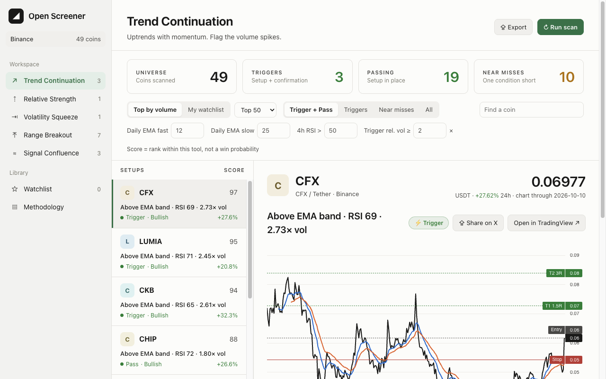

# Open Screener

An open-source, multi-strategy crypto market research workbench. Independent strategies scan the market,
each one explains its evidence in plain English, and **Signal Confluence** shows where they agree.

Runs entirely in your browser on free public market data. No account, no API key, no server.

**Research only. Not financial advice.**

[Open the live demo](https://dalejullien.github.io/open-screener/) · [Read the product case study](docs/CASE_STUDY.md)



## Why it exists

Chart review is slow and discretionary. Open Screener turns repeatable market observations into transparent scanners, then makes their ranking, historical tests and forward outcomes inspectable. It is designed as a research instrument, not a black-box signal feed.

## What it does

| Tool | Finds |
|---|---|
| ★ **S-Tier Setups** | RSI-reset pullbacks, tight-base (VCP) breakouts and squeeze breakouts with tight structure-based stops, graded S / A / B with a rule-by-rule checklist |
| ↗ **Trend Continuation** | Daily close above the 12/25 EMA band, 4h RSI > 50, volume-spike trigger |
| ⇡ **Relative Strength** | Coins outperforming BTC over 7/30/90 days, ranked by percentile |
| ⇥ **Volatility Squeeze** | Bollinger width in the bottom 15% of its own history, and the breakout after |
| ⤒ **Range Breakout** | Close above the 20-day range high, confirmed by volume |
| ⌁ **Chart Patterns** | Double tops/bottoms, (inverse) head & shoulders, triangles and wedges with Forming / Confirmed / Failed states and labelled drawings |
| ∿ **Pattern Match** | The 5 most similar historical shapes across all coins, what followed them, and a weighted estimate |
| ≋ **Signal Confluence** | Coins where several strategies fire at once |
| ◷ **Backtests** | Every strategy replayed over 120–365 days: win rate, average R, profit factor, drawdown, equity curve, every trade |
| ≣ **Forward Journal** | Append-only first-seen ideas with original rank, regime, liquidity, levels, MFE/MAE and outcome |

Every coin gets an interactive candlestick and volume chart with instant setup/entry timeframe switching,
full-screen review, keyboard navigation, the strategy's overlays, the exact rule that fired, example
trigger/invalidation/target levels with example risk sizing, a **Share on X** card (copied to your clipboard,
ready to paste into the post), and one-click **research links**: the project's official X account,
live cashtag posts, DEX Screener (resolved from the official contract), CoinGecko, website,
GitHub, TradingView and Binance.

- Every Binance market: ~550 crypto coins (spot + perpetuals), plus tokenized/perp stocks and commodities
- 1-hour, 4-hour, daily, 3-day and weekly timeframes (entries one step lower: 15m, 1h, 4h, daily)
- Live prices every minute; rescans at every 4h/daily close; history cached locally for instant reloads
- "Detected on" dates, NEW badges and 7-day rank changes for every setup
- Universe: top N by 24h volume, or **your TradingView watchlist** (Export list → import)
- Signals use **completed bars only** — they never repaint
- Light / dark / system theme
- Full rules for every tool on the **Methodology** page

## Run it

Requires Node.js 20+.

```bash
npm install
npm run dev
```

Open http://localhost:5173.

Run the release checks:

```bash
npm test
npm run lint
npm run build
```

## Architecture and product notes

- [Architecture](docs/ARCHITECTURE.md)
- [Product case study](docs/CASE_STUDY.md)
- [Privacy](PRIVACY.md)
- [Security](SECURITY.md)

## Add a strategy

Each strategy is one file implementing the `Scanner` interface (`src/lib/types.ts`):

```ts
export const myStrategy: Scanner = {
  id: "my-strategy",
  name: "My Strategy",
  tagline: "One line on what it finds.",
  icon: "◆",
  params: [{ key: "length", label: "Length", default: 20 }],
  methodology: "Plain-English rules, shown on the Methodology page.",
  run({ asset, daily, h4 }, params, ctx) {
    // return a Signal: status, direction, score, headline, reason, metrics, levels, chart overlays
  },
};
```

Register it in `src/scanners/index.ts` and it appears in the sidebar, in Confluence and on the
Methodology page automatically. See [CONTRIBUTING.md](CONTRIBUTING.md).

## Project layout

```
src/
  scanners/     one file per strategy + registry/confluence
  lib/          types, indicators (EMA, RSI, ATR, Bollinger…), trade-plan maths, share card
  data/         Binance public data client, universe selection, watchlist import
  components/   sidebar views, list/detail, chart
```

## Roadmap

1. ✅ Multi-strategy dashboard, confluence, watchlist import, share cards, research links
2. ✅ Backtests, signal history, 3-day/weekly, Chart Patterns, Pattern Match
3. Pattern Match + Chart Pattern backtests; tune S-tier gates against out-of-sample results
4. Validate ranking by market regime, liquidity band and forward outcomes
5. Optional alerts only after the research states are statistically reliable

## Data

Market data comes from Binance's public market-data API (`data-api.binance.vision`), requested
directly by your browser. Charts use TradingView's open-source
[Lightweight Charts](https://github.com/tradingview/lightweight-charts) (Apache-2.0).

## Licence

[AGPL-3.0](LICENSE). You can use, modify and self-host it freely. If you run a modified version
as a network service, you must publish your source code under the same licence.

## Disclaimer

This software is for research and education. It does not provide financial advice, and
nothing it shows is a recommendation to buy or sell. Scores rank setups; they are not win
probabilities. Trading crypto carries substantial risk of loss.
